# Cloud Computing Project Report

## CloudLink: Serverless URL Shortener with Expiring Links

**Student Name:** Harsh Pandey and Saksham Singh  
**Roll Number:** 2410030994, 2410030795  
**Program / Semester:** B.Tech CSE Core, Year 3 / Semester 5th  
**Course:** Cloud Computing  
**Faculty:** Mr. Rohit Kumar  
**Submission Date:** 24-11-2026

## Abstract

CloudLink is a cloud-hosted URL shortener built with Cloudflare Workers and Workers KV. Users submit a long HTTP or HTTPS URL, optionally choose a custom alias, and select a link lifetime. A Cloudflare Worker validates the request, stores the alias-to-destination mapping in managed key-value storage, and redirects visitors to the original destination. The project demonstrates serverless computing, managed cloud storage, HTTP APIs, edge deployment, validation, and expiry-based data lifecycle management without requiring a virtual machine.

## 1. Problem Statement

Long web addresses are inconvenient to share and difficult to remember. A URL shortening service provides a compact link that redirects to the original destination. The service should store mappings in the cloud, respond to public web requests, reject malformed input, prevent duplicate custom aliases, and allow temporary links to expire automatically.

## 2. Objectives

- Build a responsive web interface for URL shortening.
- Validate destination URLs and accept only HTTP/HTTPS protocols.
- Generate random aliases or accept optional custom aliases.
- Detect duplicate custom aliases.
- Store mappings persistently in a managed cloud key-value store.
- Support never-expiring, 24-hour, 7-day, and 30-day links.
- Redirect visitors to the original URL and return a clear 404 for missing or expired links.
- Deploy the application as a serverless cloud service.

## 3. Technology Stack

| Component | Technology | Responsibility |
|---|---|---|
| User interface | HTML, CSS, JavaScript | URL form, alias and expiry inputs, result display, copy action |
| Serverless compute | Cloudflare Workers | HTTP routing, validation, alias generation, persistence calls, redirects |
| Cloud storage | Cloudflare Workers KV | Persistent alias-to-destination mappings and expiration |
| Deployment tooling | Wrangler CLI | Local preview, account authentication, namespace binding, deployment |
| Runtime | JavaScript Web APIs | Request/Response handling, URL parsing, UUID generation |

## 4. System Architecture

The Worker serves the user interface and API, while Workers KV stores link mappings. The two request paths are shown separately below.

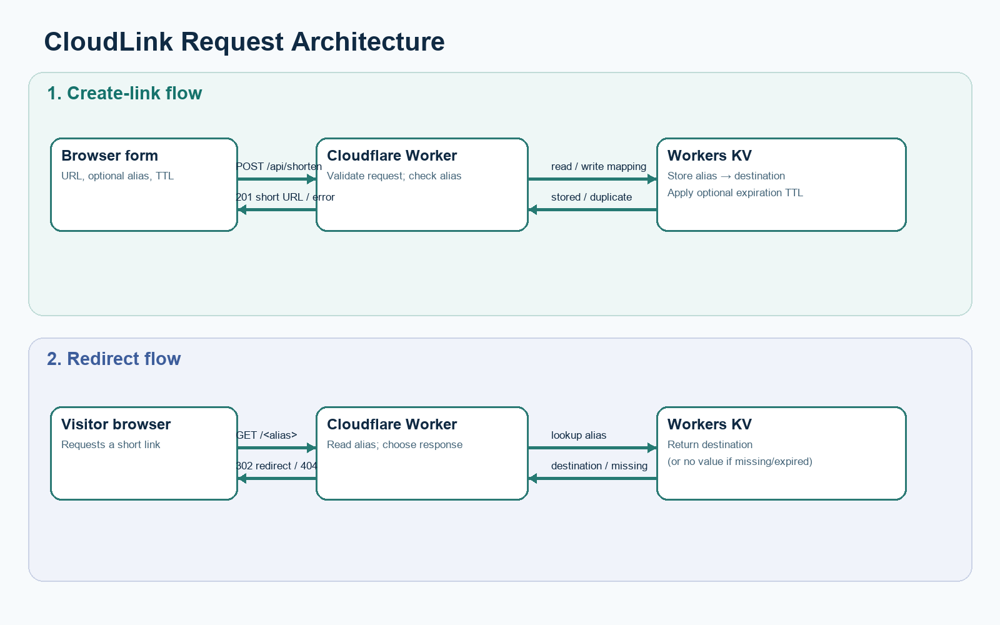

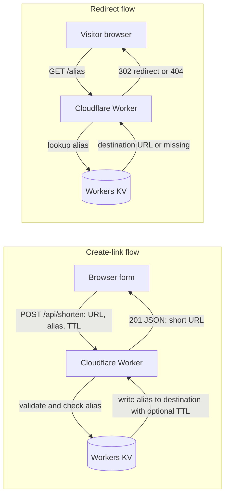

The Worker is the compute layer and serves both the user interface and API. Workers KV is the managed storage layer. The deployment does not require a user-managed server or virtual machine. The application depends on provider availability, usage quotas, and account configuration.

## 5. Request Workflow

### Create a short link

1. A user enters a destination URL and optionally provides a custom alias and expiry duration.
2. The browser sends `POST /api/shorten` with a JSON request body.
3. The Worker parses the URL and accepts only `http` or `https` protocols.
4. If the user supplied an alias, the Worker validates its format and checks whether it already exists. Otherwise, the Worker generates a random seven-character alias and checks for collisions.
5. The Worker writes the alias-to-destination mapping to Workers KV. For expiring links, it supplies the selected TTL to KV [2, 7].
6. The Worker returns the public short URL as JSON, and the interface displays a copyable result.

### Resolve a short link

1. A visitor opens `GET /<alias>`.
2. The Worker reads the mapping from KV.
3. If a mapping exists, the Worker returns HTTP `302` to the destination URL.
4. If the mapping is missing or expired, the Worker returns HTTP `404`.

## 6. API Design

### `POST /api/shorten`

Example request:

```json
{
  "url": "https://example.com/articles/cloud-computing",
  "alias": "cloud-demo",
  "ttl": 604800
}
```

The `alias` field is optional. Supported TTL values are `0` (no expiry), `86400` (24 hours), `604800` (7 days), and `2592000` (30 days).

Example success response (`201 Created`):

```json
{
  "alias": "cloud-demo",
  "shortUrl": "https://your-worker.workers.dev/cloud-demo",
  "message": "Link created; it will expire automatically."
}
```

### `GET /<alias>`

`GET /<alias>` returns HTTP `302` when a mapping exists and `404` when it is missing or expired. `HEAD /<alias>` resolves the same mapping and returns redirect headers without a response body.

## 7. Cloud Computing Concepts Demonstrated

- **Serverless computing:** the provider runs the request-handling code without requiring the student to provision or patch a VM [4].
- **Managed storage:** Workers KV stores application data behind a binding exposed to the Worker [2].
- **On-demand execution:** application logic runs in response to HTTP requests.
- **Edge deployment:** the Worker is deployed on Cloudflare's network close to visitors; routing and performance are still subject to provider behavior and current plan limits.
- **Data lifecycle management:** KV expiration automatically removes temporary link mappings after their selected TTL.
- **Cloud deployment workflow:** Wrangler authenticates to the account, binds a managed namespace, and publishes the Worker.

## 8. Cloud Analysis

### Why serverless instead of a virtual machine?

For this small URL-shortening workload, serverless avoids paying for an always-running virtual machine when requests are idle. The provider starts and scales the request-handling code as traffic arrives, while managing the host operating system and runtime infrastructure. This reduces routine server patching and capacity planning. A VM can still be a better choice when an application needs a long-running process, custom operating-system control, or predictable continuously high utilization.

### Current free-tier limits checked on 24 November 2026

Cloudflare's official pricing page lists Workers Free at **100,000 requests per day** and **10 ms CPU time per invocation** [4, 5]. Workers KV Free lists **100,000 reads per day, 1,000 writes per day, 1,000 deletes per day, 1,000 list requests per day, and 1 GB stored data** [4, 6]. These are account/service limits, not a performance guarantee; check the linked pricing and limits pages before deployment because provider terms can change.

Sources: [Cloudflare Workers pricing](https://developers.cloudflare.com/workers/platform/pricing/), [Workers limits](https://developers.cloudflare.com/workers/platform/limits/), and [Workers KV limits](https://developers.cloudflare.com/kv/platform/limits/).

### Scalability and performance

Workers can serve requests across Cloudflare's network and scale without the student configuring a VM fleet [5]. KV is designed for frequent reads and globally cached data, which suits short-link redirects. The first read in a location may be slower than a cached read, and a recent write may take 60 seconds or more to become visible elsewhere [7]. The free-tier request, CPU, and KV operation limits also apply [4–6]. This report does not claim a measured throughput or latency benchmark; those require a controlled load test.

### Platform comparison

| Aspect | Cloudflare Workers + KV | AWS Lambda + DynamoDB |
|---|---|---|
| Cost model | Workers Free: 100,000 requests/day and 10 ms CPU/invocation; KV Free: 100,000 reads/day, 1,000 writes/day, 1 GB stored. Paid usage is usage-based [4, 6]. | Lambda charges by requests and execution duration; AWS lists 1 million requests and 400,000 GB-seconds/month in its Lambda free tier. DynamoDB offers provisioned and on-demand modes; free-tier capacity/storage eligibility depends on account and table configuration [8, 9]. |
| Startup / cold start | Isolate-based execution is lightweight; startup and end-to-end latency still depend on code, network, and platform behavior. | Lambda creates/reuses execution environments. A new environment can add cold-start initialization latency; provisioned concurrency can reduce it at added cost [8]. |
| Storage | Workers KV is a global, eventually consistent key-value store with automatic TTL on keys. | DynamoDB is managed key-value/document storage with configurable capacity, TTL, and per-request consistency options. |
| Consistency | Eventually consistent across locations; cached negative lookups can delay observing a newly created key [7]. | Regional table reads can be eventually consistent by default, with strongly consistent reads available for supported operations; global-table modes have their own replication semantics [10]. |
| Deployment | Wrangler CLI deploys the Worker and declares KV bindings in `wrangler.toml`. | Typically deploy Lambda and configure an IAM role, DynamoDB table, and often API Gateway or another HTTP endpoint. |
| Ease for this prototype | One platform and one CLI for the Worker, public endpoint, and KV binding. | More AWS concepts and service configuration, but broader integration and database options. |

AWS references: [Lambda pricing](https://aws.amazon.com/lambda/pricing/), [DynamoDB pricing](https://aws.amazon.com/dynamodb/pricing/), [Lambda execution environments](https://docs.aws.amazon.com/lambda/latest/dg/lambda-runtime-environment.html), and [DynamoDB read consistency](https://docs.aws.amazon.com/amazondynamodb/latest/developerguide/HowItWorks.ReadConsistency.html). AWS free-tier eligibility and limits can depend on account age, Region, capacity mode, and current offer terms; verify before use.

## 9. Validation and Test Plan

Run these checks against the live deployment and record the observed results before submission.

| Test | Expected result | Observed result |
|---|---|---|
| Submit a valid HTTPS URL | Short link is returned | Passed: created a short link for the Cloud Computing article |
| Open the generated short link | Browser redirects to the destination | Passed: browser reached the Cloud Computing article |
| Submit an HTTP URL | Short link is returned | Passed: alias `b293629` created; GET returned `302` with `Location: http://example.com/`. |
| Submit an invalid URL | Validation error is shown | Passed after the reviewed deployment: HTTP 400, `{"error":"Enter a valid http or https URL."}` (Figure 7 shows the HTTP status). |
| Send JSON `null` to the shorten API | HTTP 400 JSON error; Worker remains available | Passed after the reviewed deployment: HTTP 400, `{"error":"Please send a JSON object."}`. |
| Submit CloudLink's own URL as the destination | HTTP 400 prevents a redirect loop | Passed after the reviewed deployment: HTTP 400, `{"error":"Cannot shorten a CloudLink URL."}`. |
| Submit a URL longer than 2048 characters | HTTP 400 rejects the request | Passed after the reviewed deployment: HTTP 400, `{"error":"URL must be 2048 characters or fewer."}`. |
| Create a custom alias | Returned link uses the chosen alias | Passed: created aliases `hp-cloud-2411` and `demo-hp-2411`; GET on `hp-cloud-2411` returned `302` with `Location: https://en.wikipedia.org/wiki/Cloud_computing` (Figure 3). |
| Reuse an existing custom alias | Duplicate alias error is returned | Passed: UI displayed “That alias is already taken. Try another one.” for `hp-cloud-2411` (Figure 4). |
| Open an unknown alias | HTTP 404 is returned | Passed: `/unknown-2411` displayed “Short link not found or expired” (Figure 5). |
| Create a short-lived link | KV expiration is configured for selected duration | Passed: UI created `ttl-hp2411-2` with the 24-hour option; UI stated it will expire automatically. Actual expiration after 24 hours was not observed. |
| Send `HEAD` for a valid alias | HTTP 302 and destination `Location` are returned | Passed after the reviewed deployment: `HEAD /codex-head-241124` returned HTTP 302 with `Location: https://developers.cloudflare.com/workers/`. |

**Live deployment URL:** https://cloudlink-shortener.harsh7523pandey202657.workers.dev  

### Live Demo Evidence

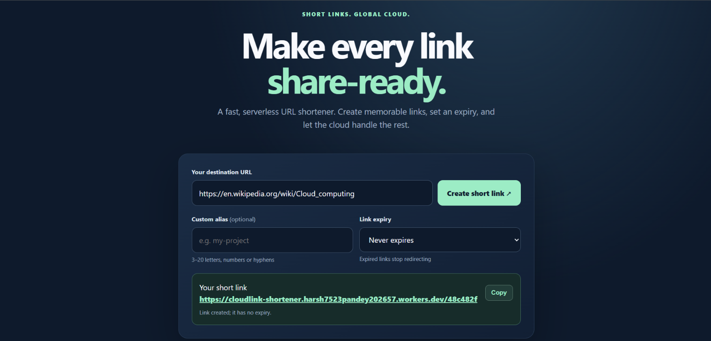

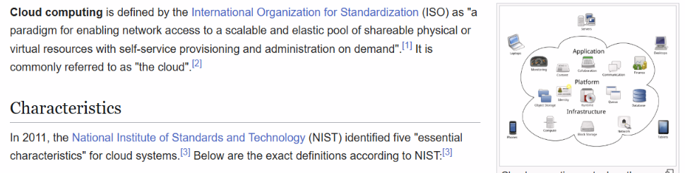

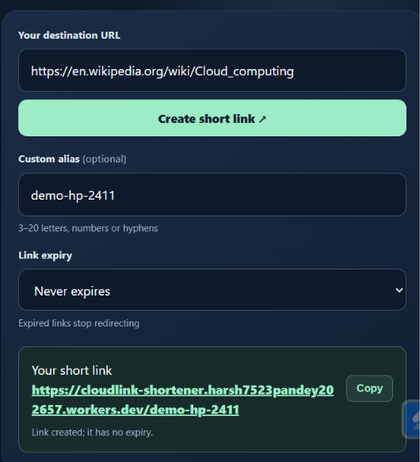

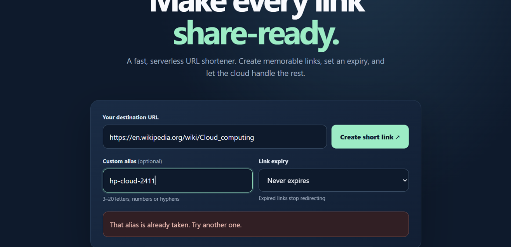

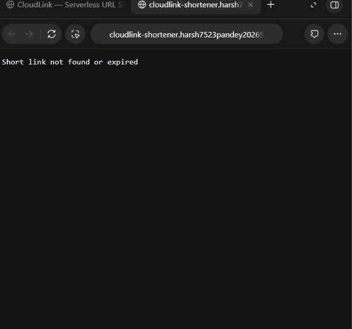

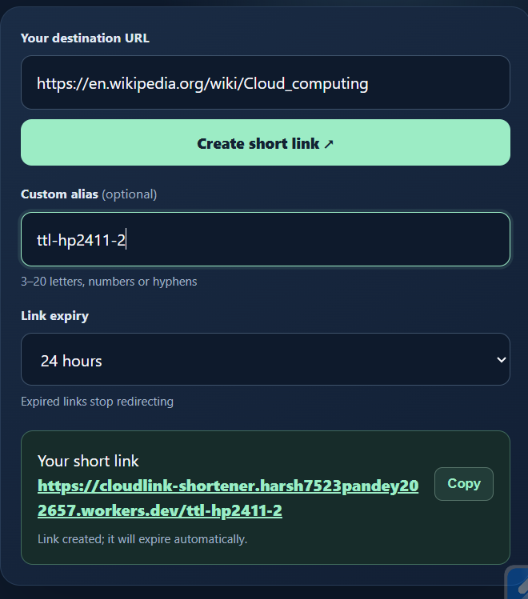

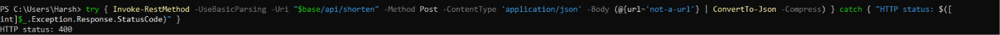

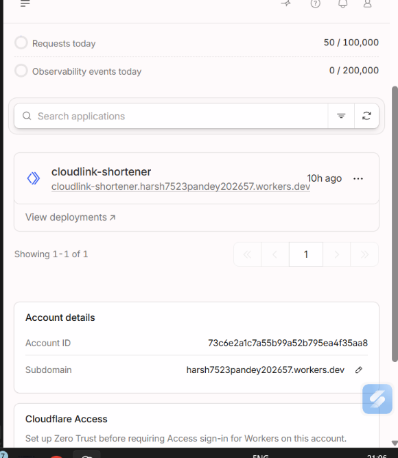

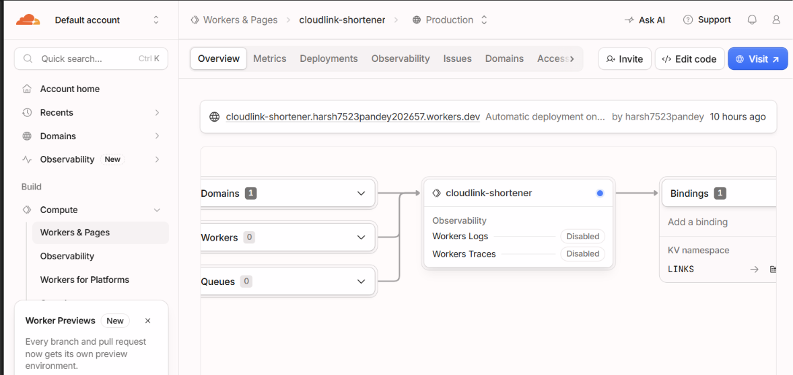
## 10. Security, Limitations, and Future Improvements

The application validates the destination protocol and alias format and reports duplicate custom aliases. Aliases are case-sensitive: `Cloud` and `cloud` are different keys. Workers KV is eventually consistent. Writes are usually visible immediately in the location that made them, but other locations may take 60 seconds or more to observe the change; a cached “key not found” lookup can also delay visibility of a newly created link [7]. In this project the duplicate check (`get`) and the later `put` are separate operations. Two concurrent requests for the same alias can both observe it as unused and then write it, because KV does not provide an atomic check-and-create transaction [7]. This limitation is consistent with KV's eventual-consistency model.

This is a classroom prototype; it does not include user authentication, abuse reporting, rate limiting, click analytics, or a moderation workflow. A production service should add authentication where appropriate, request limits, abuse prevention, monitoring, and a storage design that provides transactional uniqueness. Only public, non-sensitive URLs should be used in a classroom demonstration.

Possible extensions include user accounts, click analytics, QR-code generation, bulk URL import, custom domains, admin moderation, and a dashboard showing link usage and expiry.

## 11. Source Code and Contribution

**GitHub repository:** https://github.com/harsh7523pandey-a11y/cloudlink-serverless-url-shortener

Harsh and Saksham configured the Cloudflare account and KV namespace, deployed the Worker with Wrangler, ran the live URL/API checks recorded here, and captured the screenshots. Coding and report preparation also used AI assistance; the team should follow the faculty's rules for acknowledging that assistance. The open-source repository [L480/url-shortener](https://github.com/L480/url-shortener) [1] was consulted as a reference for the Workers + KV URL-shortener pattern. The CloudLink interface and configuration were customized for this course demonstration. The reference repository uses Apache-2.0; retain its copyright and license notice for any code reused from it, and identify copied files accurately.

## 12. Deployment Procedure

1. Install Node.js and run `npm install` in the project directory.
2. Authenticate with `npx wrangler login` and verify the account with `npx wrangler whoami`.
3. Create a KV namespace using `npx wrangler kv namespace create LINKS`.
4. Copy the returned namespace ID into `wrangler.toml`, replacing the placeholder.
5. Run `npx wrangler deploy` and note the generated `workers.dev` URL.
6. Run the validation checks above and capture screenshots of the live interface and redirect.

Detailed commands and cleanup notes are in `cloudlink-worker/README.md`. Always check the current account plan and quotas before deployment.

### Deployment issue observed

The first deployment attempt failed because the KV namespace ID in `wrangler.toml` did not match the namespace in the Cloudflare account. Running `wrangler kv namespace list`, correcting the configured ID, and deploying again resolved the binding error. This showed that a KV binding name alone is insufficient: the Worker configuration must reference the correct namespace resource ID.

## 13. Conclusion

CloudLink demonstrates an end-to-end serverless cloud application. A browser-based interface calls a serverless HTTP API; the Worker validates input, uses managed cloud storage, and returns redirects. Optional aliases and TTL-based expiry make the demonstration richer while keeping the architecture small enough to deploy and explain in a classroom presentation.

## References

1. L480, “url-shortener,” GitHub: https://github.com/L480/url-shortener
2. Cloudflare, “Workers KV — Get started”: https://developers.cloudflare.com/kv/get-started/
3. Cloudflare, “KV namespaces”: https://developers.cloudflare.com/kv/concepts/kv-namespaces/
4. Cloudflare, “Workers pricing”: https://developers.cloudflare.com/workers/platform/pricing/
5. Cloudflare, “Workers limits”: https://developers.cloudflare.com/workers/platform/limits/
6. Cloudflare, “Workers KV limits”: https://developers.cloudflare.com/kv/platform/limits/
7. Cloudflare, “How KV works”: https://developers.cloudflare.com/kv/concepts/how-kv-works/
8. AWS, “Lambda pricing”: https://aws.amazon.com/lambda/pricing/
9. AWS, “DynamoDB pricing”: https://aws.amazon.com/dynamodb/pricing/
10. AWS, “DynamoDB read consistency”: https://docs.aws.amazon.com/amazondynamodb/latest/developerguide/HowItWorks.ReadConsistency.html
